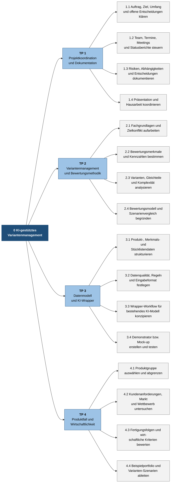

# Projektstrukturplan (PSP): KI-gestütztes Variantenmanagement

> **Status:** Entwurf zur Abstimmung im Team und mit Steffen Feld. Arbeitspakete und Zuständigkeiten sind Vorschläge, keine bereits bestätigte Rollenverteilung.

**Projektgruppe:** 6  
**Teamgröße:** 7 Personen  
**Projektleitung:** du  
**Stand:** 05.11.2026

## 1. Projektziel

Für eine noch auszuwählende Produktgruppe wird ein Konzept und, sofern im Umfang möglich, ein Demonstrator für einen KI-gestützten Variantenmanagement-Ansatz erarbeitet. Ein Wrapper bindet ein bestehendes KI-Modell ein; ein eigenes Modell wird nicht trainiert. Der Ansatz soll Markt-/Kundennutzen, Wirtschaftlichkeit und Fertigungskomplexität nachvollziehbar gegeneinander abwägen.

## 2. PSP-Übersicht

*Abbildung: Projektstrukturplan – Gesamtprojekt (Ebene 0), Teilprojekte (Ebene 1) und Arbeitspakete (Ebene 2)*

## 3. Arbeitspakete und Ergebnisse

| PSP | Arbeitspaket | Ergebnis / Abnahmepunkt |
| --- | --- | --- |
| 1.1 | Auftrag und Umfang | Abgestimmtes Ziel, Produktfall, erwarteter Reifegrad und Abgrenzung |
| 1.2–1.3 | Projektsteuerung | Rollen, Terminplan, Status, Risiken und Entscheidungen aktuell dokumentiert |
| 1.4 | Präsentation und Bericht | Präsentation am 17.12.2026 und Hausarbeit bis 15.01.2027 gemäß Planung |
| 2.1–2.2 | Grundlagen und Kriterien | Begründete Kriterien für Markt/Kunde, Wirtschaftlichkeit und Fertigung |
| 2.3–2.4 | Analyse und Bewertungsmodell | Transparente Regeln oder Bewertungsmethode samt Annahmen und Szenariovergleich |
| 3.1–3.2 | Datenmodell | Beschriebenes Eingabeformat mit Datenprüfungen und markierten Datenlücken |
| 3.3 | KI-Wrapper | Ablauf, Modellaufruf, Instruktionen, Eingaben und Ausgabe beschrieben; kein eigenes Training |
| 3.4 | Demonstrator | Vorführbarer Ablauf an freigegebenen, anonymisierten oder synthetischen Beispieldaten, falls genehmigt |
| 4.1–4.2 | Produkt- und Marktfall | Abgegrenzte Produktgruppe und belegte Anforderungen/Marktannahmen |
| 4.3–4.4 | Wirtschaftlichkeit und Szenarien | Vergleich des Ausgangsportfolios mit mindestens einer begründeten Alternative, soweit Daten reichen |

## 4. Vorläufige Rollenverteilung für sieben Personen

Die KW45-Notiz nennt Zuständigkeiten für einzelne nächste Aufgaben. Diese werden hier als Startvorschläge genutzt, nicht als bestätigte dauerhafte Rollen.

| Person / Rolle | Vorgeschlagener Schwerpunkt | Bezug zum vorhandenen Stand |
| --- | --- | --- |
| Du – Projektleitung | Gesamtkoordination, Entscheidungen nachhalten, Abhängigkeiten und Freigaben steuern | Nutzerangabe: Projektleitung |
| Lukas H. | Roadmap und Termin-/Fortschrittsübersicht | In KW45 für die Roadmap vorgesehen |
| David W. | Recherche zu Variantenmethoden und Bewertungsansätzen | In KW45 für methodische Vorbereitung vorgesehen |
| Jonas F. | Präsentation und Ergebnisintegration | In KW45 für die erste Präsentation vorgesehen |
| Teammitglied 5 – Name ergänzen | Produktgruppe, Kundenanforderungen, Markt/Wettbewerb | Vorschlag; Name und Zuständigkeit bestätigen |
| Teammitglied 6 – Name ergänzen | Wirtschaftlichkeit, Fertigungskomplexität und Kennzahlen | Vorschlag; Name und Zuständigkeit bestätigen |
| Teammitglied 7 – Name ergänzen | Datenmodell, Wrapper-Workflow und Demonstrator | Vorschlag; Name und Zuständigkeit bestätigen |

**Zusammenarbeit:** Die Methodik benötigt Input aus Produktfall, Markt und Fertigung. Das Daten-/Wrapper-Arbeitspaket setzt die gemeinsam abgestimmten Kriterien um. Jede Empfehlung wird von mindestens einer fachlich zuständigen Person gegengeprüft; die Projektleitung entscheidet nicht allein über fachliche Portfolioinhalte.

## 5. Grobe zeitliche Zuordnung

| Zeitraum laut Timeline | PSP-Schwerpunkt | Geplantes Ergebnis |
| --- | --- | --- |
| KW46 | 1.1, 4.1 | Umfang, Produktgruppe, Datenzugang und Kriterien mit Steffen abstimmen |
| KW47 | 2.2, 3.1–3.2, 4.2 | Merkmals-/Datenmodell und Anwendungsfall |
| KW48 | 2.3–2.4, 3.3 | Bewertungslogik und Wrapper-Konzept |
| KW49 | 3.4, 4.3–4.4 | Demonstration und Szenarienvergleich |
| KW50 | 2–4 | Ergebnisse plausibilisieren, Grenzen dokumentieren, Präsentation/Hausarbeit strukturieren |
| KW51 | 1.4 | Abschlusspräsentation und Review |
| KW52–KW2 | 1.4 | Hausarbeit erstellen und bis 15.01.2027 finalisieren |

Die Termine sind aus der vorhandenen Timeline übernommen und müssen bei Änderungen aktualisiert werden. Die erste Projektpräsentation ist laut Unterlagen am 11.11.2026 um 18:00 Uhr abzugeben.

## 6. Vor Freigabe zu bestätigen

- Produktgruppe und konkreter Anwendungsfall.
- Konzept, Mock-up oder lauffähiger Demonstrator als erwarteter Ergebnisumfang.
- Verfügbare und zulässige Daten; Einwilligung für externe Modellanbieter oder Vorgabe für lokalen Betrieb.
- Bewertungsmerkmale, Kennzahlen und Gewichtungen.
- Namen und tatsächliche Zuständigkeiten der drei noch nicht eingetragenen Teammitglieder.
- Zuständigkeit für gemeinsame Ergebnisintegration und finale Qualitätsprüfung.
